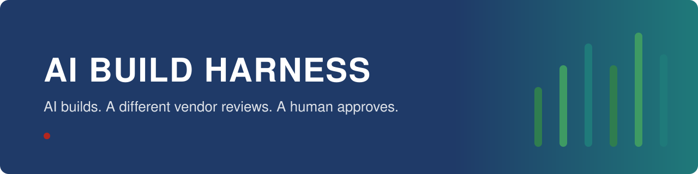
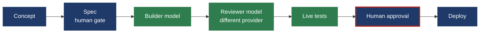

<picture>
  <source media="(prefers-color-scheme: dark)" srcset="assets/harness-banner.svg">
  
</picture>


A multi-model pipeline that turns a rough product idea into reviewed, tested, working code, for anyone who wants AI speed without trusting any single model. A human writes and approves the spec, one AI builds, an AI from a different company reviews, and nothing ships without live tests and human approval.

## How it works



- The concept is challenged by a second AI before the human sees it, and only product decisions reach the human.
- The builder writes code, writes its own tests, runs the real system and repairs failures within set limits.
- The reviewer reads only the spec and the finished code from disk, never the builder's reasoning.
- n8n workflows are deployed to a test instance and executed against fixtures before approval.

## Key features

- **Cross-vendor review:** the code refuses to start if builder and reviewer come from the same provider.
- **Human approval gates:** concept, spec lock and deployment. Nothing auto-deploys.
- **Ten model roles** across four providers, each set in `config/models.yaml`.
- **Bounded runs:** retry caps, tool-turn caps and a per-run token ceiling.
- **Decision memory:** every gate decision is logged, and patterns are regenerated from the logs, never edited by hand.
- **Real verification:** 460+ automated tests, and builders must run the real system, not just write code that looks right.

## Tech stack

Python 3.12, LangGraph, OpenRouter (Anthropic, OpenAI, Google and DeepSeek models), Langfuse tracing, n8n, Claude Code. The working rules the AI team follows are in [AGENTS.md](AGENTS.md).

## Status

A personal working system, shared to show how it is built. The `memory/` and `projects/` folders are empty here on purpose, and the skills the rules mention are not included in this public copy.

## Setup

```
python -m venv .venv
pip install -r requirements.txt
cp .env.example .env     # add your own OpenRouter and Langfuse keys
python -m pytest tests -q
```

## Licence

All rights reserved. You are welcome to read it, but it is not licensed for reuse or redistribution.
